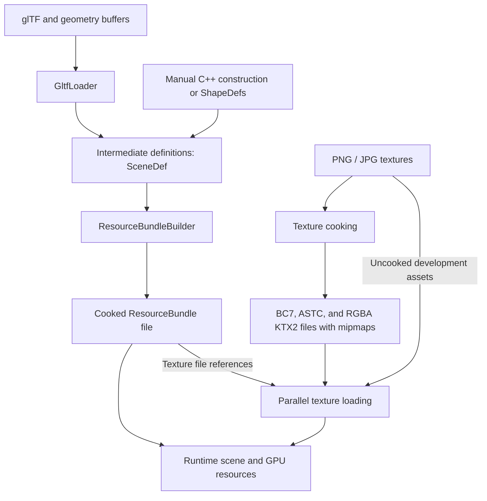

# Asset Flow

Assets pass through three stages: raw files, intermediate definitions, and
cooked resources. Cooking turns definitions into data ready for runtime use.
The goal is to save cooked resources to files and load those at runtime instead
of importing glTF.

## Intended flow

Cooked textures stay in individual files so they can load in parallel. At
runtime, the loader selects an available texture encoding supported by the
device.

## Intermediate definitions

[`SceneDef`](../../src/SceneTypes.h) holds the data used to build a bundle:

- `MeshDef` holds vertices, indices, and a `MaterialDef`.
- `MaterialDef` describes surface properties and a texture path.
- `ModelDef` groups meshes under a name.
- Nodes describe transforms and hierarchy, refer to models by name, and can
  include camera or light definitions. Physics definitions belong to root nodes.
- `PointLightDef` and `DirectionalLightDef` hold RGB colors. The owning node's
  transform supplies the point light's position or directional light's orientation.

[`GltfLoader`](../../src/GltfLoader.cpp) produces these definitions from glTF.
A glTF mesh becomes a `ModelDef`, and each primitive becomes a `MeshDef`.

Code can also build the definitions directly. For example, create a mesh with
[`ShapeDefs::Box`](../../src/ShapeDefs.h), assign its material, add it to a named
`ModelDef`, and reference that model from a node in `SceneDef`. Hand-authored,
generated, and imported definitions all use the same cooking path.

## Cooking a bundle

[`ResourceBundleBuilder::Build`](../../src/ResourceBundle.cpp) takes a
`SceneDef` and produces a [`ResourceBundle`](../../src/ResourceBundle.h). It
packs geometry and resource records into one buffer, shares duplicate strings,
texture paths, and materials, resolves model names to indices, computes bounds,
and flattens the node hierarchy.

The builder records cameras and lights attached to nodes. Point and directional
lights have separate resource arrays. Each light record stores its color and
owning node index, with spatial information kept in the node's transform.

The bundle owns its buffer. Its accessors return read-only views that remain
valid while the bundle exists. Intermediate definitions can be discarded after
building it.

## What exists today

[`Level::CreateTask`](../../src/Level.cpp) accepts scene definitions, imports
glTF, or loads cooked resource bundles. [`Scene`](../../src/Scene.cpp) creates
runtime nodes, physics bodies, cameras, and lights. If the bundle contains no cameras,
it adds a camera on a new root node with an identity transform. Cameras can be
enumerated or looked up by their owning node’s name.

Camera controllers modify local position and rotation directly.
`Scene::Update()` synchronizes physics and updates world transforms.
[`View`](../../src/View.cpp) renders using the scene’s first camera.

Point and directional lights can be enumerated through `Scene`. Their runtime
wrappers refer to the owning scene nodes. Point lights use the node's position,
and directional lights use its world-space +Z axis. Changing a node's transform
also affects its other attached components and descendants.

If the bundle contains no directional lights, `Scene` adds a white directional
light on a new root node with a default rotation. `View` uploads directional-light
directions and colors to GPU storage each frame. The
[`color shader`](../../src/shaders/ColorShader.wgsl) combines their diffuse
contributions with a fixed ambient term.

Point-light rendering is not implemented yet. Point lights are collected into
the runtime scene, and `View` allocates and binds a GPU buffer for them, but it
does not populate that buffer and the color shader does not evaluate them.

The [Cook tool](../../tools/Cook/Cook.cpp) writes resource bundles and separate
`.bc7.ktx2`, `.astc.ktx2`, and uncompressed `.rgba.ktx2` texture files with mipmaps.

During development, the runtime can load PNG/JPEG files directly from uncooked
assets.

[TextureLoader](../../src/TextureLoader.cpp) loads individual textures, and
[TextureFetcher](../../src/TextureFetcher.cpp) manages the collection of
texture-loading tasks. Failed texture loads log an error and use the default
texture. Loading continues for the remaining textures.
