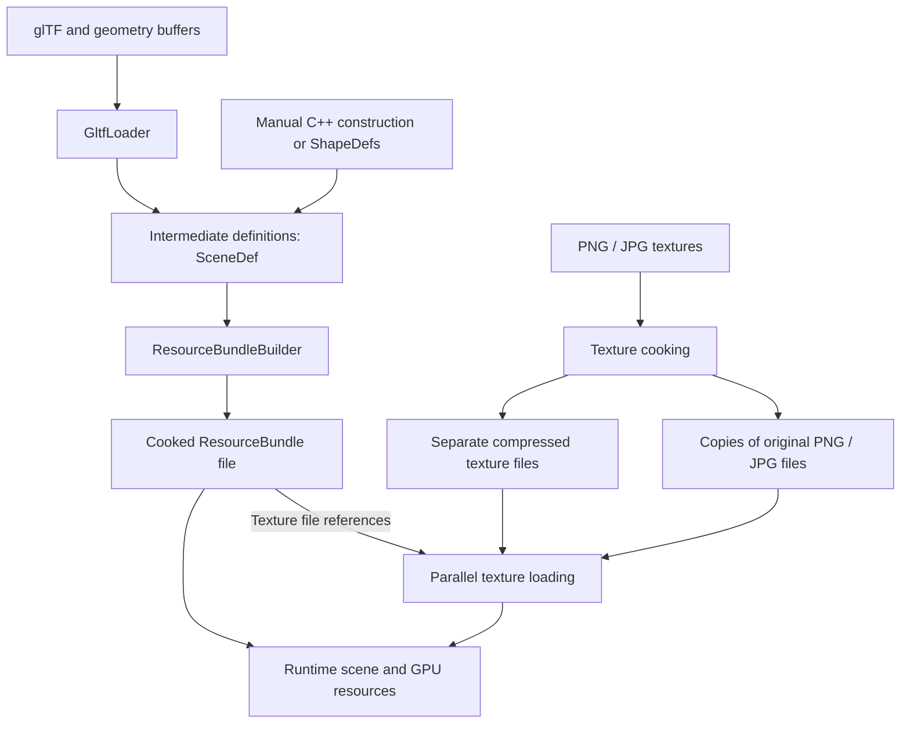

# Asset Flow

Assets pass through three stages: raw files, intermediate definitions, and
cooked resources. Cooking turns definitions into data ready for runtime use.
The goal is to save cooked resources to files and load those at runtime instead
of importing glTF.

## Intended flow

Cooked textures stay in individual files so they can load in parallel. Each
texture resource stores its original path and flags indicating which additional
encodings are available. The loader derives the compressed filename from the
original path when both the availability flag and GPU support permit that
encoding. Compressed pixel data uploads without image decoding at runtime.

## Intermediate definitions

[`SceneDef`](../../src/SceneTypes.h) holds the data used to build a bundle:

- `MeshDef` holds vertices, indices, and a `MaterialDef`.
- `MaterialDef` describes surface properties and a texture path.
- `ModelDef` groups meshes under a name.
- Nodes describe transforms and hierarchy, refer to models by name, and can
  include physics definitions on roots.

[`GltfLoader`](../../src/GltfLoader.cpp) produces these definitions from glTF.
A glTF mesh becomes a `ModelDef`, and each primitive becomes a `MeshDef`.

Code can also build the definitions directly. For example, create a mesh with
[`ShapeDefs::Box`](../../src/ShapeDefs.h), assign its material, add it to a named
`ModelDef`, and reference that model from a node in `SceneDef`. Hand-authored,
generated, and imported definitions all use the same cooking path.

## Cooking a bundle

[`ResourceBundleBuilder::Build`](../../src/ResourceBundle.cpp) takes a
`SceneDef` and produces a [`ResourceBundle`](../../src/ResourceBundle.h). It
packs geometry and resource records into one buffer, shares duplicate strings,
texture paths, and materials, resolves model names to indices, computes bounds,
and flattens the node hierarchy.

The bundle owns its buffer. Its accessors return read-only views that remain
valid while the bundle exists. Intermediate definitions can be discarded after
building it.

## What exists today

[`Level::CreateTask`](../../src/Level.cpp) accepts scene definitions, imports
glTF, or loads cooked resource bundles. [`Scene`](../../src/Scene.cpp) creates
runtime nodes and physics, and [`View`](../../src/View.cpp) creates GPU resources.

The [Cook tool](../../tools/Cook/Cook.cpp) writes resource bundles and separate
compressed texture files. It also copies the original PNG/JPG files for devices
without support for the available compressed formats. No mipmaps are generated
for these PNG/JPEG files.  Mipmaps are only generated for cooked/compressed textures.

Before generating mipmaps, the cooker resizes the base image to satisfy the
selected compression format’s block dimensions, rounding up where necessary.
It then generates a full mip chain down to 1×1 and compresses each level.
Partial blocks in smaller levels repeat edge pixels instead of rescaling the
image.

Each custom `.bc7` texture file contains a header with the base dimensions, format,
and mip count, followed by tightly packed mip levels from largest to smallest.
The file does not include GPU upload-row padding.

At runtime, texture-loading workers copy the mip data into mapped staging
memory, adding the required row padding for each level. The main thread creates
the GPU texture and records the copies for all levels.

Currently supported compression formats:

- BC7

The Cook tool marks the generated encodings as available when building the bundle. Bundles built
directly from scene definitions or glTF use the default flags, which indicate no
additional encodings.

[TextureLoader](../../src/TextureLoader.cpp) selects a compressed file only when the
resource advertises its encoding and the device supports it.
If the GPU supports none of the available compression formats, or no compressed
encoding is available, it uses the original PNG/JPEG file. The image is decoded
at runtime and uploaded without mipmaps (only the base level).
[TextureFetcher](../../src/TextureFetcher.cpp) manages the collection of
texture-loading tasks.

## Supported KTX2 subset

The cooker also writes KTX2 files containing the same compressed mip data.
`TextureLoader::LoadFromFile()` recognizes KTX2 by its file identifier and loads
the following subset:

- No supercompression. `supercompressionScheme` must be zero and supercompression
  global data must be absent. The mip payloads are already GPU block-compressed
  data. The loader does not inflate Zstandard or zlib data, or transcode Basis
  Universal textures.
- Non-array 2D textures with one face. Texture arrays, cubemaps, and 3D textures
  are unsupported.
- sRGB transfer with BT.709 primaries and straight alpha. Premultiplied alpha,
  linear transfer, and other color primaries are unsupported. The loader does
  not convert color spaces or alpha representations.
- Currently, `VK_FORMAT_BC7_SRGB_BLOCK` is the only supported pixel format. The
  device must support BC7. The Data Format Descriptor must match the cooker's
  single basic descriptor, including its color and alpha conventions.
- An explicit, nonzero mip count, up to the maximum for the base dimensions.
  Partial mip chains are accepted. The loader does not generate missing mips.
- Base dimensions from 4 to 4096 pixels in each direction, divisible by four,
  following the current engine's BC7 dimension requirements. Small mip levels
  still occupy whole compression blocks.

Header, descriptor, key/value section, and mip ranges are checked before staging.
Each mip must have the expected byte size and alignment and must not overlap
metadata or another mip. Unsupported representations and invalid ranges fail
loading.

Optional key/value data is skipped after checking its section range. Orientation,
swizzle, and other key/value metadata are not applied, so files must already use
the orientation and channel interpretation expected by the engine.

KTX2 stores its mip payloads smallest first. The loader uses the level index to
stage each mip into its destination range, adding upload-row padding on the
worker. Staging-buffer creation and GPU commit stay on the main thread.
`LoadFromResource()` selects `.bc7.ktx2` files when the bundle advertises BC7 and
the device supports it. Otherwise, it loads the original PNG/JPEG file.
