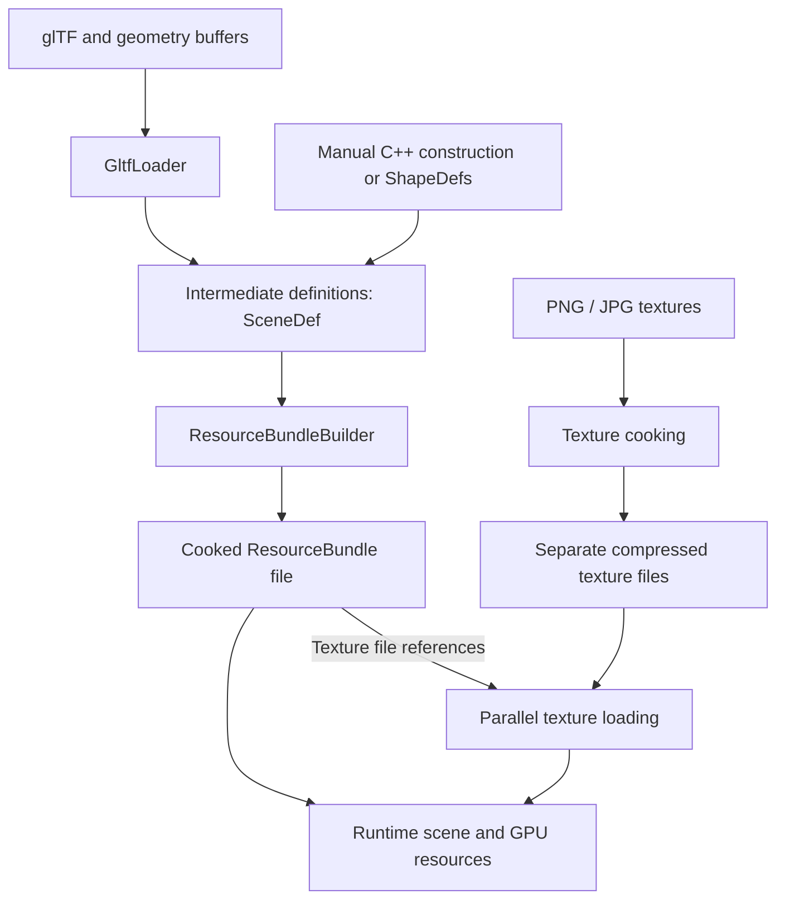

# Asset Flow

Assets pass through three stages: raw files, intermediate definitions, and
cooked resources. Cooking turns definitions into data ready for runtime use.
The goal is to save cooked resources to files and load those at runtime instead
of importing glTF.

## Intended flow

Cooked textures stay in individual files so they can load in parallel. The
bundle references those files. Their compressed format will allow direct
loading, with image decoding and compression handled during cooking.

## Intermediate definitions

[`SceneDef`](../../src/SceneTypes.h) holds the data used to build a bundle:

- `MeshDef` holds vertices, indices, and a `MaterialDef`.
- `MaterialDef` describes surface properties and a texture path.
- `ModelDef` groups meshes under a name.
- Nodes describe transforms and hierarchy, refer to models by name, and can
  include physics definitions on roots.

[`GltfLoader`](../../src/GltfLoader.cpp) produces these definitions from glTF.
A glTF mesh becomes a `ModelDef`, and each primitive becomes a `MeshDef`.

Code can also build the definitions directly. For example, create a mesh with
[`ShapeDefs::Box`](../../src/ShapeDefs.h), assign its material, add it to a named
`ModelDef`, and reference that model from a node in `SceneDef`. Hand-authored,
generated, and imported definitions all use the same cooking path.

## Cooking a bundle

[`ResourceBundleBuilder::Build`](../../src/ResourceBundle.cpp) takes a
`SceneDef` and produces a [`ResourceBundle`](../../src/ResourceBundle.h). It
packs geometry and resource records into one buffer, shares duplicate strings,
texture paths, and materials, resolves model names to indices, computes bounds,
and flattens the node hierarchy.

The bundle owns its buffer. Its accessors return read-only views that remain
valid while the bundle exists. Intermediate definitions can be discarded after
building it.

## What exists today

[`Level::CreateTask`](../../src/Level.cpp) accepts scene definitions, imports
glTF, or loads cooked resource bundles. [`Scene`](../../src/Scene.cpp) creates
runtime nodes and physics, and [`View`](../../src/View.cpp) creates GPU resources.

The Cook tool writes resource bundles and separate, uncompressed RGBA texture
files. Runtime texture loading supports both cooked textures and PNG/JPG images.
Compressed texture cooking and loading remain planned.
